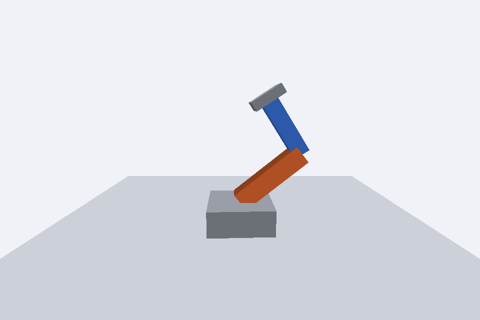

# Aula de Grafo de Cena: Python e OpenGL
Prof. Rodrigo Fernandes dos Santos. Computação Gráfica, Unipac Barbacena.

## Ambiente
Python 3.11 a 3.13, Pygame 2.6.1, PyOpenGL 3.1.10 e NumPy 1.26 ou 2.x.
A placa de vídeo precisa oferecer OpenGL 3.2 core.

## Windows (PowerShell)
Abra o terminal na pasta `alunos`.
```powershell
py -3 -m venv .venv
.venv\Scripts\python.exe -m pip install -r requirements.txt
.venv\Scripts\python.exe demo1_cena.py
.venv\Scripts\python.exe demo2_hierarquia.py
.venv\Scripts\python.exe demo3_camera.py
```

## macOS (Terminal)
Abra o terminal na pasta `alunos`.
```bash
python3 -m venv .venv
.venv/bin/python -m pip install -r requirements.txt
.venv/bin/python demo1_cena.py
.venv/bin/python demo2_hierarquia.py
.venv/bin/python demo3_camera.py
```

No PyCharm, abra a pasta `alunos` como projeto e execute cada arquivo com **Run**.

ESC fecha a janela. P salva a captura em `capturas/resultado.png`.

## Demonstrações
| Arquivo | O que mostra | Teclas |
|---|---|---|
| `demo1_cena.py` | A receita: Renderer, Scene, Camera e Mesh (Geometry + Material) | — |
| `demo2_hierarquia.py` | Sistema solar com pivôs (`Object3D` vazio) | ESPAÇO pausa |
| `demo3_camera.py` | A câmera como Object3D, presa a um "rig" | WASD, QE, RF, setas |

## Organização
- `core/`: `Base`, `Matrix`, `Attribute`, `Uniform`, `Object3D`, `Scene`, `Camera`, `Mesh` e `Renderer`.
- `geometry/`: `Geometry` e `BoxGeometry` (posições e uma cor por face).
- `material/`: `Material` e `BasicMaterial` (shaders com `baseColor` e cores por vértice).
- `formas.py`: `caixa(largura, altura, profundidade, cor)` cria uma Mesh em forma de caixa.
- `atividade_braco.py`: arquivo inicial da atividade (veja `ATIVIDADE.md`).

## Convenções
- `getWorldMatrix() = pai.getWorldMatrix() @ transform`.
- `translate`, `rotateX/Y/Z` e `scale` são **locais** por padrão (`localCoord=True`, multiplica à direita).
- `setPosition` troca só a translação da matriz local, sem mexer na rotação.
- Velocidades em unidades ou radianos **por segundo**, multiplicadas por `self.deltaTime`.
- `self.isKeyPressed('w')` é contínuo; `self.isKeyDown('space')` vale só no quadro em que a tecla foi apertada.

## Problemas comuns
- O objeto não aparece: ele não foi adicionado à cena (nem a um pai que está na cena).
- Gira em torno do centro em vez da ponta: falta um pivô (`Object3D`) na articulação.
- Filho gira junto com o "irmão": confira qual objeto é o pai em `add`.
- `ModuleNotFoundError: core`: execute a partir da pasta `alunos`.

## Referência
STEMKOSKI, Lee; PASCALE, Michael. *Developing graphics frameworks with Python and OpenGL*. Boca Raton: CRC Press, 2022. Capítulo 4 (A Scene Graph Framework).

## Atividade 2 – Braço Robótico

**Disciplina:** Computação Gráfica

**Atividade:** Braço Robótico – Grafo de Cena

**Integrante 1:** Carlos Eduardo Santos Almeida

**Integrante 2:** Lucas de Souza Carmo

### Descrição da implementação

A atividade consiste no desenvolvimento de um braço robótico articulado utilizando Python e OpenGL, aplicando os conceitos de grafo de cena e transformações hierárquicas.

Foi implementada uma estrutura composta por uma base cinza, um braço laranja, um antebraço azul e uma garra cinza. Para permitir a movimentação adequada das articulações, foram utilizados objetos `Object3D` como pivôs do ombro e do cotovelo.

Os elementos foram organizados hierarquicamente, permitindo que a rotação da base movimente toda a estrutura, enquanto os movimentos do ombro e do cotovelo sejam realizados de maneira independente, respeitando as relações entre os objetos.

As rotações foram implementadas utilizando os métodos `rotateY()` e `rotateZ()`, com controles pelo teclado. A variável `self.deltaTime` foi utilizada para manter a velocidade dos movimentos proporcional ao tempo de execução.

### Controles

- **A / D:** giram a base e toda a estrutura em torno do eixo Y.
- **W / S:** movimentam o ombro em torno do eixo Z.
- **I / K:** movimentam o cotovelo em torno do eixo Z.
- **Tecla P:** registra uma captura de tela do resultado.

### Resposta da questão conceitual

**Por que foi necessário utilizar pivôs em vez de simplesmente girar diretamente as caixas que representam o braço e o antebraço?**

A utilização de pivôs foi necessária para permitir que as rotações acontecessem nos pontos corretos das articulações. Ao girar diretamente as caixas, a rotação ocorreria em torno de seus próprios centros, dificultando a representação adequada dos movimentos do braço robótico.

Com os pivôs `Object3D`, foi possível definir pontos específicos para o ombro e o cotovelo, permitindo que cada articulação realizasse seu movimento sem comprometer as conexões entre as peças.

Além disso, a organização hierárquica do grafo de cena permite que os objetos filhos acompanhem as transformações de seus respectivos pais. Dessa forma, ao movimentar o ombro, o braço, o antebraço e a garra acompanham o movimento, enquanto a rotação do cotovelo afeta apenas o antebraço e a garra.

### Resultado da execução

O programa foi executado e os movimentos das articulações foram testados, confirmando o funcionamento dos controles de rotação da base, do ombro e do cotovelo.

A captura de tela apresenta o braço robótico com suas peças conectadas e posicionadas corretamente.

