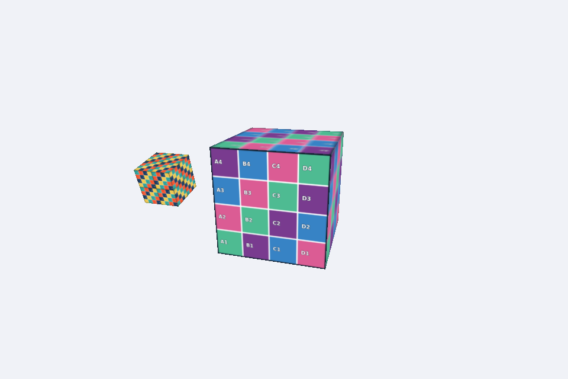

# Aula de Texturas: Python e OpenGL
Professor Rodrigo Fernandes dos Santos. Ciência da Computação.
## Ambiente
Python 3.11 a 3.13, Pygame 2.6.1, PyOpenGL 3.1.10, NumPy 1.26 ou 2.x.
A placa e o driver devem oferecer contexto OpenGL 3.2 core e GLSL 150.
A instalação das dependências requer internet uma vez. A aula usa texturas locais e funciona sem downloads depois da instalação.
## Windows (PowerShell)
Abra o terminal na pasta alunos.
```powershell
py -3.12 -m venv .venv
.venv\Scripts\python.exe -m pip install -r requirements.txt
.venv\Scripts\python.exe exemplo_retangulo.py
.venv\Scripts\python.exe exemplo_retangulo.py --repetir 2
.venv\Scripts\python.exe exemplo_cubo.py
```
## macOS (Terminal)
Abra o terminal na pasta alunos.
```bash
python3 -m venv .venv
.venv/bin/python -m pip install -r requirements.txt
.venv/bin/python exemplo_retangulo.py
.venv/bin/python exemplo_retangulo.py --repetir 2
.venv/bin/python exemplo_cubo.py
```
`--repetir 2` aplica repeatUV = [2,2] ao retângulo (slide 19).

ESC fecha a janela. S salva a captura em capturas/resultado.png, relativa à pasta de onde o programa foi iniciado.
## Organização
core: Base, Matrix, Object3D, Scene, Camera, Attribute, Uniform, Texture, Mesh, Renderer.
geometry: Geometry, RectangleGeometry, BoxGeometry.
material: Material, TextureMaterial.
shaders: código GLSL. images: grade_uv.png e mosaico.png.
## Relação com o livro
Arquitetura e nomes das classes seguem Stemkoski e Pascale, capítulos 3 a 5.
Este é um subconjunto didático independente, reimplementado para a aula, e não o repositório oficial completo. Pode ser executado sem substituir o projeto anterior dos alunos.
As classes incluem getWorldMatrix, rotateX/Y/Z, Texture.loadImage/uploadData e vertexUV.
Adaptações: argumentos opcionais evitam dicionários mutáveis compartilhados; setPosition usa indexação compatível com NumPy 2; matrizes usam GL_FALSE e armazenamento por colunas; caminhos derivam de __file__; Base solicita explicitamente OpenGL 3.2 core.
O livro usa texture2D e uniform texture. Em GLSL 150 core a função é texture. O uniform chama-se textureSampler para evitar colisão de nomes. Os slides e arquivos usam essa versão.
TextureMaterial mantém repeatUV, offsetUV e baseColor. O uniform sampler2D guarda [textureRef, 1]. O valor enviado ao shader é 1, o número da unidade, e não textureRef ou GL_TEXTURE1.
Transparência: o código combina blending e descarte de alpha menor que 0.10 como no capítulo. As imagens desta aula são opacas. Transparência parcial exige cuidados adicionais de ordenação e não integra o exercício.
## Problemas comuns
Imagem não encontrada: confira images e o nome do arquivo.
Janela não abre: confira suporte a OpenGL 3.2 core e driver atualizado. Sessões remotas podem oferecer outro contexto.
Imagem invertida: mantenha a inversão vertical na conversão RGBA.
Textura branca/preta: confira sampler, unidade e UV.
Rotação irregular: use velocidade em radianos por segundo multiplicada por deltaTime.
## Referência
STEMKOSKI, Lee; PASCALE, Michael. Developing graphics frameworks with Python and OpenGL. Boca Raton: CRC Press, 2022. DOI: 10.1201/9781003181378. Seções 5.1 a 5.4.
Documentação: https://www.pygame.org/docs/ref/display.html e https://pyopengl.sourceforge.net/documentation/manual-3.0/glUniform.html
As texturas foram criadas para este material e podem ser usadas na atividade.

## Verificação realizada
Os dois exemplos e a solução do professor renderizaram com OpenGL 4.5 core (Mesa) em Linux e Python 3.12.14, e também no macOS com Python 3.13.2 (Pygame 2.6.1, PyOpenGL 3.1.10, NumPy 2.5.2). Shaders compilaram e o ciclo de desenho terminou sem erro OpenGL. A orientação da grade foi conferida nas capturas. O Windows tem instruções e contexto 3.2 core preparado, mas não foi testado diretamente. No macOS, Material cria um VAO temporário antes de compilar os shaders, pois o perfil core exige um VAO vinculado na validação do programa.


## Atividade 3 – Cubo com Satélite Texturizado

**Disciplina:** Computação Gráfica

**Atividade:** Cubo com Satélite Texturizado – Texturas

**Integrante 1:** Carlos Eduardo Santos Almeida

**Integrante 2:** Lucas de Souza Carmo

### Descrição da implementação

A atividade consiste no desenvolvimento de uma cena gráfica utilizando Python e OpenGL, aplicando conceitos de texturização, coordenadas UV, transformações geométricas e organização hierárquica de objetos.

Foi implementado um cubo principal utilizando a textura `mosaico.png` e um segundo cubo, representando um satélite, utilizando a textura `grade_uv.png`, com a configuração `repeatUV = [2, 2]`.

O satélite foi adicionado como filho do cubo principal por meio do método `self.mesh.add()`, posicionado a uma distância de 1.3 unidades do centro e com escala de 0.4. A ordem das transformações foi preservada para evitar que a escala alterasse a distância entre os objetos.

A movimentação foi implementada de forma que o satélite acompanhe a rotação do cubo principal enquanto realiza sua própria rotação em torno do eixo X, com velocidade constante de 2 radianos por segundo.

Também foram implementados controles para aumentar e diminuir a velocidade de rotação do cubo principal. A utilização de `self.deltaTime` permite manter os movimentos proporcionais ao tempo de execução, independentemente da taxa de quadros.

### Controles

- **Seta ↑:** aumenta a velocidade de rotação do cubo principal.
- **Seta ↓:** diminui a velocidade de rotação, podendo atingir zero.
- **Tecla S:** registra uma captura de tela do resultado.
- **Tecla ESC:** fecha a janela do programa.

### Resposta da questão conceitual

**Qual é o papel das coordenadas UV em uma textura e qual é o efeito da configuração `repeatUV = [2,2]`?**

As coordenadas UV são responsáveis por determinar como uma imagem bidimensional será aplicada à superfície de um objeto tridimensional. Elas estabelecem a correspondência entre os pontos da geometria e as posições da textura, permitindo que a imagem seja distribuída corretamente sobre as faces do objeto.

A coordenada U representa o eixo horizontal da textura, enquanto a coordenada V representa o eixo vertical.

A configuração `repeatUV = [2, 2]` faz com que a textura seja repetida duas vezes na direção horizontal e duas vezes na direção vertical. Dessa forma, considerando uma face com coordenadas UV de 0 a 1, a imagem aparece quatro vezes, formando uma distribuição de 2 × 2.

Essa configuração permite controlar a repetição da imagem sobre a superfície sem modificar a geometria ou as dimensões do objeto.

### Resultado da execução

O programa foi executado e os movimentos dos dois cubos foram testados, confirmando o funcionamento da rotação do cubo principal, do movimento orbital do satélite e de sua rotação independente em torno do eixo X.

Os controles de velocidade também foram verificados, permitindo aumentar, diminuir e interromper a rotação do cubo principal, enquanto o satélite mantém sua rotação própria.

A captura de tela apresenta os dois cubos com suas respectivas texturas aplicadas e dimensões diferentes.

